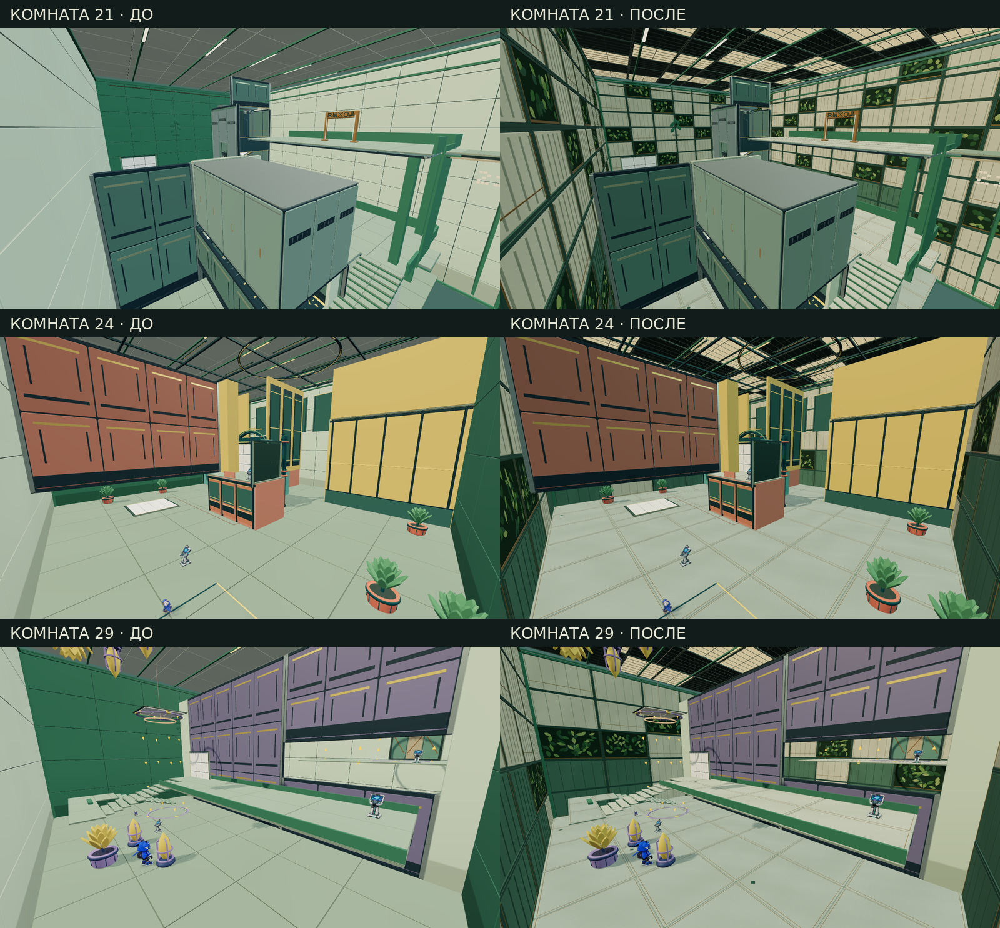

# Биосфера: визуальная переработка комнат 21–30

Игровой код: `4f31b6ad05782c912c70f924c1edbc204d3c73a0`. Исходная версия: `a38730963973834b75b11ef77a08b5ca9ff6cacc`.

Все изображения — реальные кадры двух production-сборок. Камеры и начальные состояния совпадают; изображения не являются концептами или генерацией. Код, исходные PNG, отчёты и контрольные суммы сохранены в истории Git. Публичная игра этим изменением не обновлялась.

[Сравнение всех десяти комнат](all-ten-rooms.jpg) · [Полная сводка и ограничения](summary.json) · [Источники артефактов](manifest.json)

## Что изменено

В комнатах 21–29 заменены плоские строительные панели: нефритовые рамы, светлый камень, бронзовые вставки и утопленные растительные секции с объёмными листьями. Потолки получили светлые и тёмные кассеты с металлическими переплётами. Настилы переработаны вместе с освещением. Движение листвы связано с игровым временем и отключается режимом уменьшенной анимации.

В комнате 30 сохранена особая длиннопролётная конструкция лётного ангара; обновлены настилы и материалы его стен и крыши. Она не выдаётся за идентичную переработку потолка остальных девяти комнат. Белые портальные поверхности, игровые механизмы, пути и исходные персонажи сохранены.

## Проверка

Все десять комнат новой сборки завершили по одному автоматическому прохождению в браузере при 1280×720. Исходный спутник и его физическое тело сохранялись, сбросов и возрождений в маршрутах не было. Стартовое сохранение открывало предшествующие комнаты, но не отмечало целевую пройденной.

Сохранены 70 PNG: по три совпадающих ракурса до и после, плюс кадр победы каждой новой комнаты. Все файлы проверены по SHA-256 и декодированы. Четыре структурных теста проверяют неизменность игровых контрактов десяти комнат, освобождение ресурсов, движение листвы и разделение поверхностей камня и бронзы. Это не полная приёмка кампании, не ручной плейтест и не измерение FPS на устройстве.

В первоначальной версии нового настила выявлены совпадающие по глубине лица декоративных вставок. В итоговой версии они разделены на 4 мм, углы планок стыкуются без перекрытия. Это адресное устранение причины ряби, а не обещание отсутствия всех артефактов во всей игре.

## Исходные кадры

Комната | До: обычная камера | После: обычная камера | Прохождение
---|---|---|---
21 | [PNG](room-21/before-21-start.png) | [PNG](room-21/after-21-start.png) | [JSON](room-21/after-report.json)
22 | [PNG](room-22/before-22-start.png) | [PNG](room-22/after-22-start.png) | [JSON](room-22/after-report.json)
23 | [PNG](room-23/before-23-start.png) | [PNG](room-23/after-23-start.png) | [JSON](room-23/after-report.json)
24 | [PNG](room-24/before-24-start.png) | [PNG](room-24/after-24-start.png) | [JSON](room-24/after-report.json)
25 | [PNG](room-25/before-25-start.png) | [PNG](room-25/after-25-start.png) | [JSON](room-25/after-report.json)
26 | [PNG](room-26/before-26-start.png) | [PNG](room-26/after-26-start.png) | [JSON](room-26/after-report.json)
27 | [PNG](room-27/before-27-start.png) | [PNG](room-27/after-27-start.png) | [JSON](room-27/after-report.json)
28 | [PNG](room-28/before-28-start.png) | [PNG](room-28/after-28-start.png) | [JSON](room-28/after-report.json)
29 | [PNG](room-29/before-29-start.png) | [PNG](room-29/after-29-start.png) | [JSON](room-29/after-report.json)
30 | [PNG](room-30/before-30-start.png) | [PNG](room-30/after-30-start.png) | [JSON](room-30/after-report.json)

[Структурные тесты](structural.tap) · [Лог сборки](build.log) · [Повторный связанный набор из 23 проверок](related-tests.tap).
