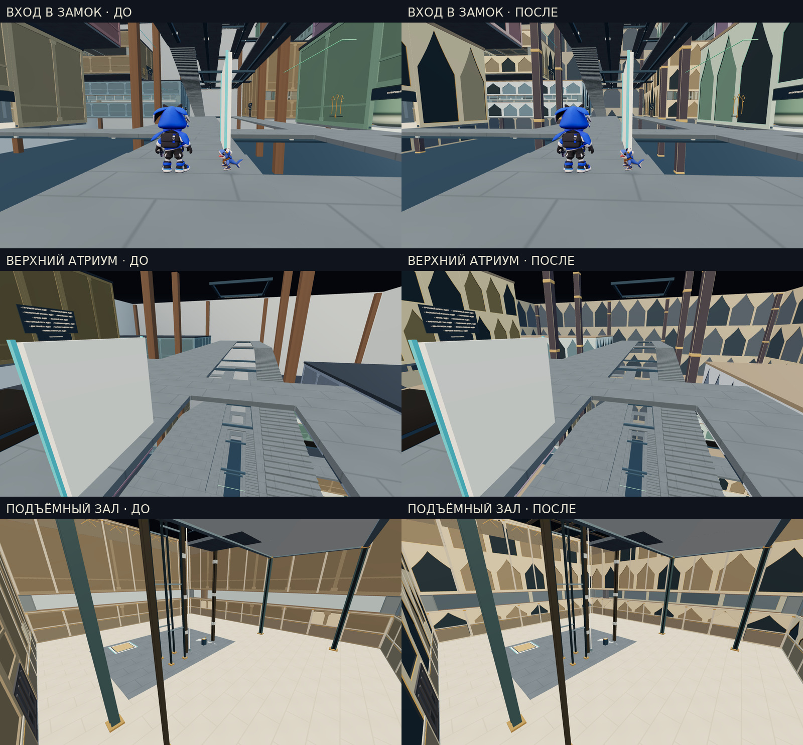

# Складчатый замок · архитектурная переработка

Проверенный игровой исходник: `92d02d1d7febfe9162c08912f6728e459403f8af`. Исходная версия сравнения: `6f4b9b58a5f51efb99492e20d54349fd5fee9add`. Код, кадры и полные отчёты сохранены в Git. Публичная игра этим пакетом не обновлялась.

В меню замок остаётся последним испытанием. Его постоянный адрес — `level=41`, внутренний индекс 40; это не перенумерация сохранений.

[Все 15 парных видов](all-views.jpg) · [Машинная сводка](summary.json) · [Исходный браузерный отчёт](native-report.json) · [61 проверка](tests.tap)

## Реальное изменение сцены

Переработаны 142 существующие строительные модели: четыре больших ограждающих стены, 109 стеновых секций крыльев, 13 потолочных плит и 16 несущих колонн. Стены получили углублённые стрельчатые ниши, потолки — цельные кессоны, колонны — профилированные стволы и пояса. Новые поверхности заменяют старую геометрию, а не накладываются вторым совпадающим слоем. Цветовое свечение отделки крыла плавно реагирует на реальное завершение его механизма и игровое время; во время паузы не продвигается.

Прежние портальные адреса, модели персонажей, управления механизмами, физические тела и их габариты сохранены. Ниши остаются закрытыми стенами, а не новыми проходами. Это не добавление новых головоломок или комнат и не завершение требования о 500 этапах.

## Проверка

Один точный набор GitHub завершился **61/61 PASS**: десять новых структурных тестов, один полный маршрут замка и 50 прежних тестов. Исходный снимок коллизий, полов, порталов, управлений, тел и стартового состояния независимо подтверждён на отдельной неизменённой копии исходной версии, затем сопоставлен с новым замком.

Полное браузерное прохождение на 1280×720 завершилось победой через все 12 действующих механизмов. Старт — обычная кнопка «Играть» до первого физического шага. Ноль сбросов, возрождений, сбросов спутника и вызовов скрытого удаления пары. Исходные акторы проверялись на каждом обновлении. Для входа использовалось тестовое сохранение ранее завершённых комнат; сам замок до запуска не пройден.

Продолжительность браузерного маршрута — 1377,75 секунды, приблизительно **22:58**. Из них счётчик движения игрока или вращения камеры отметил 1289,03 секунды. Самый длинный непрерывный интервал без движения и поворота — 13,43 секунды. Это автоматический известный маршрут, не человеческий спидран и не доказательство минимального времени прохождения. Искусственные паузы для увеличения длительности не добавлялись.

Сохранены и проверены **73 настоящих PNG**: 30 статических снимков (15 до и 15 после), 42 контрольных момента маршрута и кадр победы. Для статических сравнений камеры, позиции акторов, физический шаг и стартовое состояние совпадают. Все изображения декодированы, размеры и SHA-256 проверены. Фиксированный ракурс маятникового зала закрыт прежней перегородкой в обеих версиях; он не считается полным осмотром зала. Отдельные виды этого механизма есть в кадрах 24–26 реального маршрута.

Счётчик отрисовки на стартовом ракурсе: 406 → 410 вызовов и 435 614 → 569 562 треугольника. Это цена новой геометрии, не обещание ускорения. Аппаратные FPS и реальные телефоны этим прогоном не измерялись.

## Исходные материалы

[Снимок старого контракта](baseline-contract.json) · [Полный CPU-маршрут](castle-route.json) · [Идентификатор исходника](source-sha.txt) · [Артефакты и хеши](manifest.json)

Ракурс | До | После
---|---|---
ВХОД В ЗАМОК | [PNG](before-start.png) | [PNG](after-start.png)
НИЖНИЙ АТРИУМ | [PNG](before-atrium.png) | [PNG](after-atrium.png)
ВЕРХНИЙ АТРИУМ | [PNG](before-upper-atrium.png) | [PNG](after-upper-atrium.png)
ГРУЗОВОЙ ЗАЛ | [PNG](before-castle-freight.png) | [PNG](after-castle-freight.png)
ГИДРАВЛИЧЕСКИЙ ЗАЛ | [PNG](before-castle-sluice.png) | [PNG](after-castle-sluice.png)
ОПТИЧЕСКИЙ ЗАЛ | [PNG](before-castle-optics.png) | [PNG](after-castle-optics.png)
ПОДЪЁМНЫЙ ЗАЛ | [PNG](before-castle-hoist.png) | [PNG](after-castle-hoist.png)
АРХИВ | [PNG](before-castle-archive.png) | [PNG](after-castle-archive.png)
МАХОВИК | [PNG](before-castle-flywheel.png) | [PNG](after-castle-flywheel.png)
МАГНИТНЫЙ ЗАЛ | [PNG](before-castle-magnet.png) | [PNG](after-castle-magnet.png)
ПОДВИЖНАЯ КАРЕТКА | [PNG](before-castle-migrant.png) | [PNG](after-castle-migrant.png)
МАЯТНИК · РАКУРС ПЕРЕКРЫТ | [PNG](before-castle-pendulum.png) | [PNG](after-castle-pendulum.png)
ИНЕРЦИЯ | [PNG](before-castle-inertia.png) | [PNG](after-castle-inertia.png)
ИМПУЛЬС | [PNG](before-castle-impulse.png) | [PNG](after-castle-impulse.png)
КОРОНА | [PNG](before-castle-crown.png) | [PNG](after-castle-crown.png)

Кадры прохождения и их названия содержатся в `native-report.json`; файлы `route-01.png`–`route-42.png` и `after-won.png` сохранены рядом.
