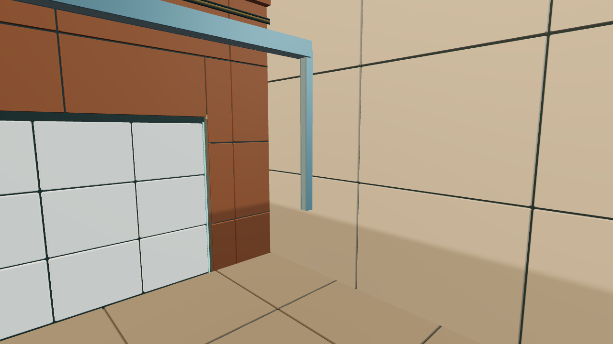
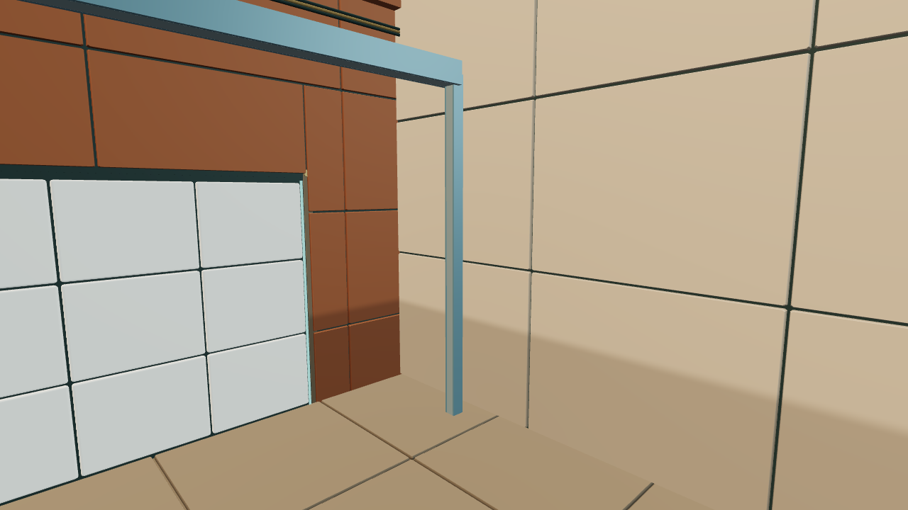
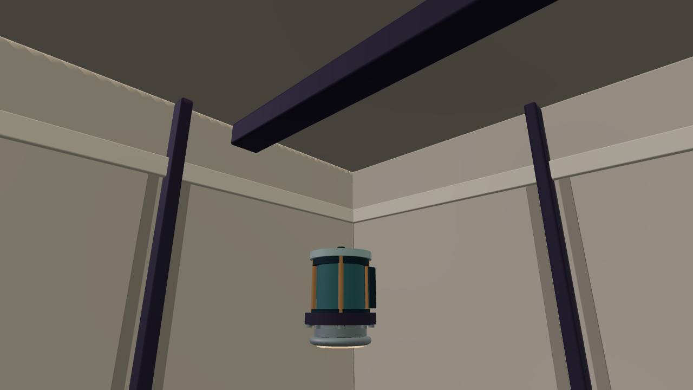
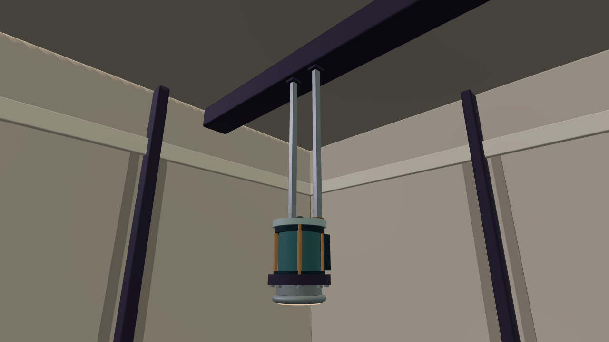
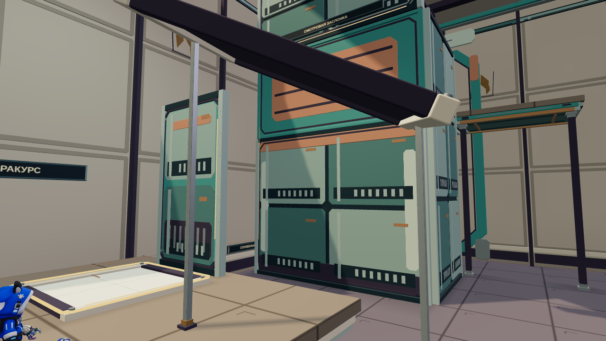

# Сохранённые результаты проверки креплений

Источник: GitHub Actions run `40572827955`, код `e3a3a2f`. SHA-256 исходных ZIP и число проверенных PNG — в [manifest.json](manifest.json).

## Запас ветра

До | После
---|---
 | 

[Полный исходный отчёт](room-11/report.json)

## Разность давлений

До | После
---|---
 | 

[Полный исходный отчёт](room-42/report.json)

## Другой ракурс

До | После
---|---
 | 

[Полный исходный отчёт](room-43/report.json)

[Незавершённый общий прогон](room-partial-full-suite/active-tests.tap) сохранён как незавершённый: не считать успешной проверкой всей игры.
