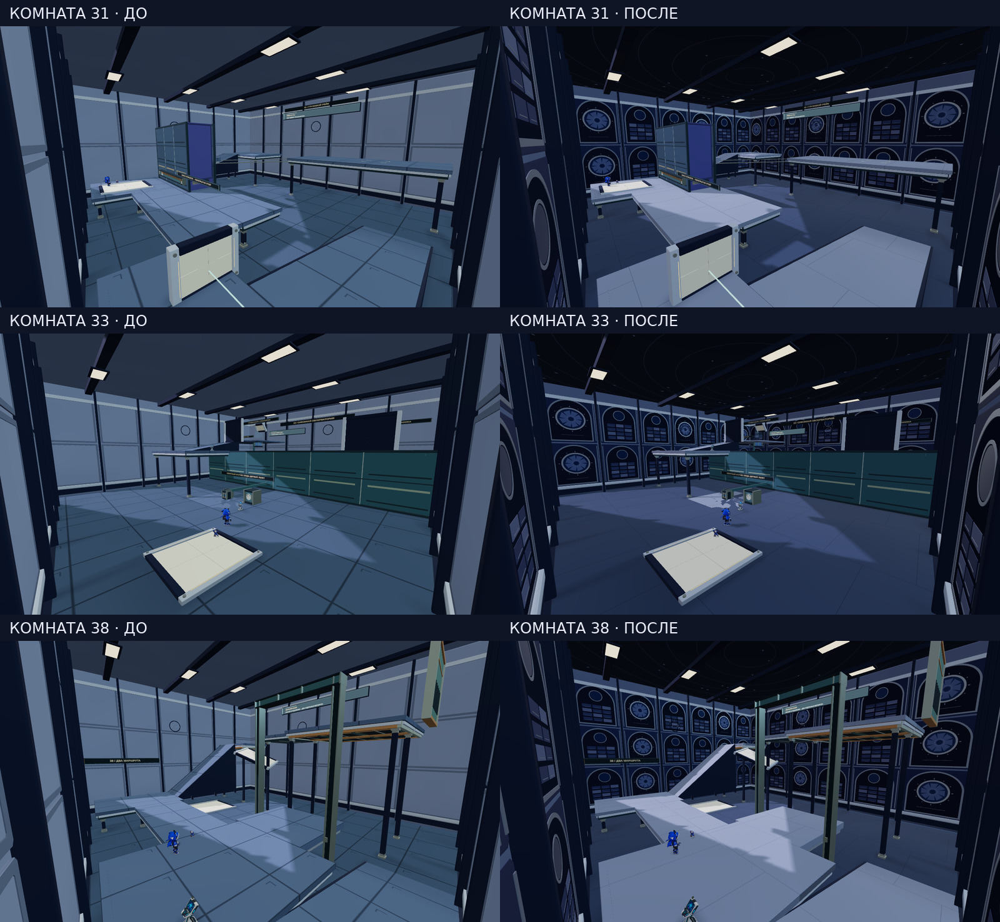

# Ночная обсерватория · комнаты 31–40

Игровой визуальный код: `868ace3397b61f3d893e2e4ff74bb1f778f63966`. Исходная версия: `e589c0ed0b0e8ea5dcac60b1b549a6adde75c32e`. Дальнейшая правка маршрутов комнат 7 и 49 не меняет этот визуальный модуль.

Все изображения сняты в обычных production-сборках. Это не концепт-арт: камеры и начальные состояния совпадают, в сравнительных листах кадры только уменьшены и подписаны. Публичный сайт и Яндекс Игры не обновлены.

[Все десять комнат](all-ten-rooms.jpg) · [Сводка](summary.json) · [Точные артефакты и хеши](manifest.json) · [26 проверок](optics-structural.tap)

## Что изменено

Прежние плоские стеновые кассеты заменены арочными серебряными секциями, индиговой отделкой, архивными панелями и утопленным рельефом диафрагм. На существующем потолке появился астрономический рисунок; напольные материалы и освещение переработаны. Диафрагмы — декоративный рельеф, не новые головоломки. Купол и новые комнаты этим пакетом не построены.

Новая геометрия находится внутри прежнего 80-мм объёма отделки. Коллизии, правила взаимодействий, белые портальные поверхности и оригинальные модели не меняются. Исходные полные игровые контракты всех десяти комнат проверены. Детали рисуются восемью группами инстансов, без добавления источников света или коллайдеров.

## Что подтверждено

Сохранены 70 исходных PNG: 30 старых статических видов, 30 новых и 10 кадров победы. Все контрольные суммы и размеры проверены, PNG декодированы. Десять новых браузерных маршрутов при 1280×720 завершились победой с исходными персонажами, без сбросов и возрождений. Во время проверки исходная сборка не изменялась. Отдельный принятый набор содержит 26 структурных и связанных проверок.

Два фиксированных обзорных ракурса комнаты 35 закрыты прежней геометрией и не выдаются за полезный осмотр: в общей галерее показан обычный стартовый вид. На части внутренних перегородок остаются прежние диагональные артефакты. Их устранение, полная приёмка кампании и измерения аппаратного FPS здесь не заявляются.

## Исходные виды

Комната | До | После | Победа
---|---|---|---
31 | [PNG](room-31/before-room-31-start.png) | [PNG](room-31/after-room-31-start.png) | [PNG](room-31/after-room-31-won.png)
32 | [PNG](room-32/before-room-32-start.png) | [PNG](room-32/after-room-32-start.png) | [PNG](room-32/after-room-32-won.png)
33 | [PNG](room-33/before-room-33-start.png) | [PNG](room-33/after-room-33-start.png) | [PNG](room-33/after-room-33-won.png)
34 | [PNG](room-34/before-room-34-start.png) | [PNG](room-34/after-room-34-start.png) | [PNG](room-34/after-room-34-won.png)
35 | [PNG](room-35/before-room-35-start.png) | [PNG](room-35/after-room-35-start.png) | [PNG](room-35/after-room-35-won.png)
36 | [PNG](room-36/before-room-36-start.png) | [PNG](room-36/after-room-36-start.png) | [PNG](room-36/after-room-36-won.png)
37 | [PNG](room-37/before-room-37-start.png) | [PNG](room-37/after-room-37-start.png) | [PNG](room-37/after-room-37-won.png)
38 | [PNG](room-38/before-room-38-start.png) | [PNG](room-38/after-room-38-start.png) | [PNG](room-38/after-room-38-won.png)
39 | [PNG](room-39/before-room-39-start.png) | [PNG](room-39/after-room-39-start.png) | [PNG](room-39/after-room-39-won.png)
40 | [PNG](room-40/before-room-40-start.png) | [PNG](room-40/after-room-40-start.png) | [PNG](room-40/after-room-40-won.png)
